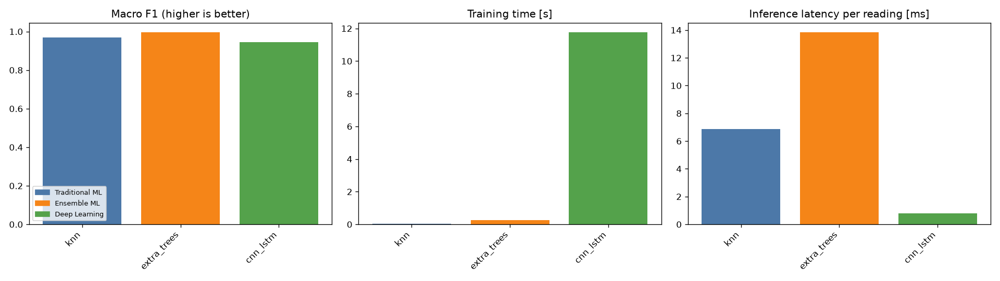
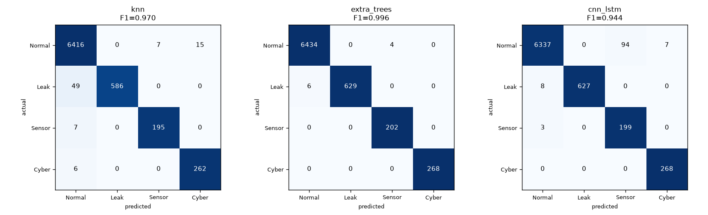

# Model evaluation report

Train readings: 17622, test readings: 7543 (contiguous-block split).

## ML and computational performance

| Model | Family | Accuracy | Precision | Recall | F1 | False-alarm rate | Train time [s] | CPU [%] | Memory [MB] | Size [KB] | Latency [ms] |
|---|---|---|---|---|---|---|---|---|---|---|---|
| knn | Traditional ML | 0.9889 | 0.9754 | 0.9656 | 0.9700 | 0.0034 | 0.04 | 113 | 3.8 | 3789 | 6.88 |
| extra_trees **(deployed)** | Ensemble ML | 0.9987 | 0.9949 | 0.9975 | 0.9962 | 0.0006 | 0.25 | 804 | 9.8 | 5679 | 13.84 |
| cnn_lstm | Deep Learning | 0.9852 | 0.9130 | 0.9892 | 0.9440 | 0.0157 | 11.76 | 619 | 117.6 | 109 | 0.78 |

## Per-class recall

| Model | NORMAL | LEAK | SENSOR_FAULT | CYBER_ATTACK |
|---|---|---|---|---|
| knn | 0.997 | 0.923 | 0.965 | 0.978 |
| extra_trees | 0.999 | 0.991 | 1.000 | 1.000 |
| cnn_lstm | 0.984 | 0.987 | 0.985 | 1.000 |

## Leak severity thresholds (leak index)

* minor < 0.257 <= moderate < 1.201 <= severe

| Leak event | Mean leak index | Suspected zone | Zone scores |
|---|---|---|---|
| leak1 | 1.257 | C | {'A': 0.479, 'B': 1.056, 'C': 1.257, 'D': 0.598} |
| leak2 | 0.238 | B | {'A': 0.116, 'B': 0.237, 'C': -0.071, 'D': -0.212} |
| leak3 | 0.288 | B | {'A': 0.129, 'B': 0.288, 'C': -0.011, 'D': -0.302} |

