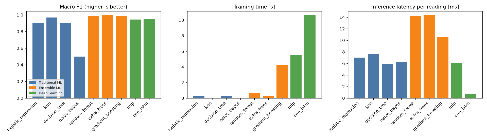
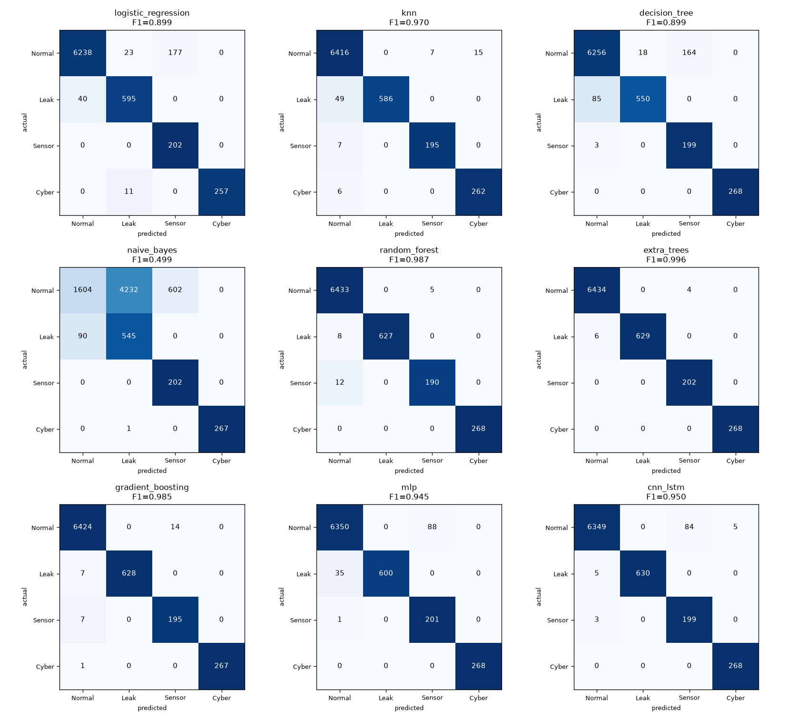

# Model evaluation report

Train readings: 17622, test readings: 7543 (contiguous-block split).

## ML and computational performance

| Model | Family | Accuracy | Precision | Recall | F1 | False-alarm rate | Train time [s] | CPU [%] | Memory [MB] | Size [KB] | Latency [ms] |
|---|---|---|---|---|---|---|---|---|---|---|---|
| logistic_regression | Traditional ML | 0.9667 | 0.8681 | 0.9662 | 0.8992 | 0.0311 | 0.26 | 156 | 5.2 | 3 | 7.02 |
| knn | Traditional ML | 0.9889 | 0.9754 | 0.9656 | 0.9700 | 0.0034 | 0.02 | 99 | 3.6 | 3789 | 7.62 |
| decision_tree | Traditional ML | 0.9642 | 0.8757 | 0.9558 | 0.8994 | 0.0283 | 0.29 | 322 | 0.2 | 10 | 5.93 |
| naive_bayes | Traditional ML | 0.3471 | 0.5780 | 0.7759 | 0.4989 | 0.7509 | 0.02 | 163 | 0.0 | 4 | 6.32 |
| random_forest | Ensemble ML | 0.9967 | 0.9928 | 0.9818 | 0.9872 | 0.0008 | 0.59 | 1026 | 0.9 | 2484 | 14.19 |
| extra_trees **(deployed)** | Ensemble ML | 0.9987 | 0.9949 | 0.9975 | 0.9962 | 0.0006 | 0.24 | 622 | 9.6 | 5679 | 14.33 |
| gradient_boosting | Ensemble ML | 0.9962 | 0.9827 | 0.9871 | 0.9848 | 0.0022 | 4.27 | 259 | 2.5 | 1094 | 10.61 |
| mlp | Deep Learning | 0.9836 | 0.9225 | 0.9816 | 0.9452 | 0.0137 | 5.55 | 384 | 69.7 | 64 | 6.13 |
| cnn_lstm | Deep Learning | 0.9871 | 0.9209 | 0.9909 | 0.9500 | 0.0138 | 10.63 | 789 | 62.7 | 109 | 0.77 |

## Per-class recall

| Model | NORMAL | LEAK | SENSOR_FAULT | CYBER_ATTACK |
|---|---|---|---|---|
| logistic_regression | 0.969 | 0.937 | 1.000 | 0.959 |
| knn | 0.997 | 0.923 | 0.965 | 0.978 |
| decision_tree | 0.972 | 0.866 | 0.985 | 1.000 |
| naive_bayes | 0.249 | 0.858 | 1.000 | 0.996 |
| random_forest | 0.999 | 0.987 | 0.941 | 1.000 |
| extra_trees | 0.999 | 0.991 | 1.000 | 1.000 |
| gradient_boosting | 0.998 | 0.989 | 0.965 | 0.996 |
| mlp | 0.986 | 0.945 | 0.995 | 1.000 |
| cnn_lstm | 0.986 | 0.992 | 0.985 | 1.000 |

## Leak severity thresholds (leak index)

* minor < 0.257 <= moderate < 1.201 <= severe

| Leak event | Mean leak index | Suspected zone | Zone scores |
|---|---|---|---|
| leak1 | 1.257 | C | {'A': 0.479, 'B': 1.056, 'C': 1.257, 'D': 0.598} |
| leak2 | 0.238 | B | {'A': 0.116, 'B': 0.237, 'C': -0.071, 'D': -0.212} |
| leak3 | 0.288 | B | {'A': 0.129, 'B': 0.288, 'C': -0.011, 'D': -0.302} |

